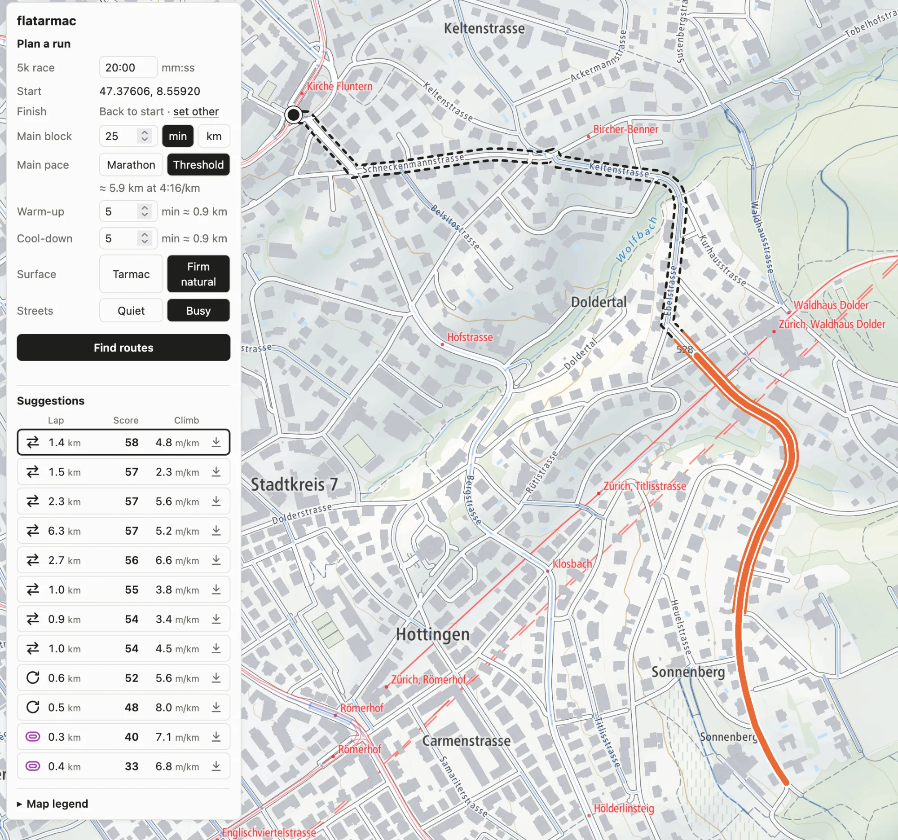
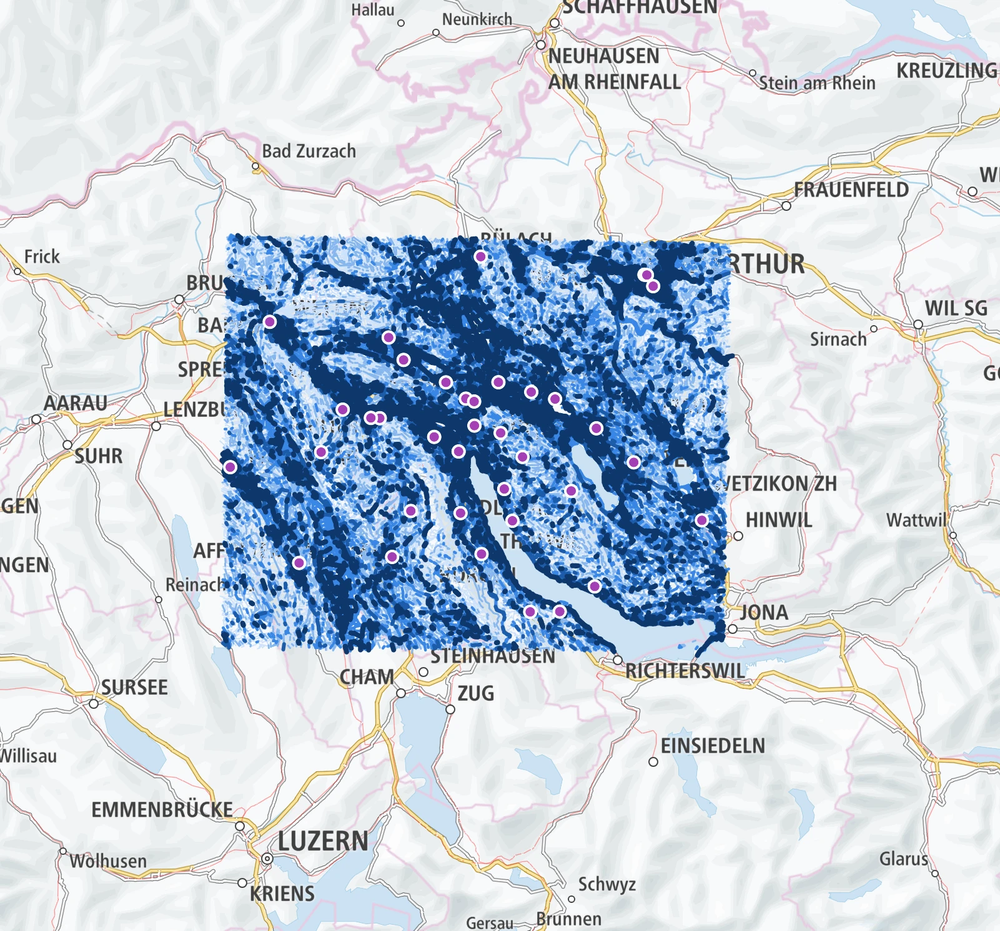
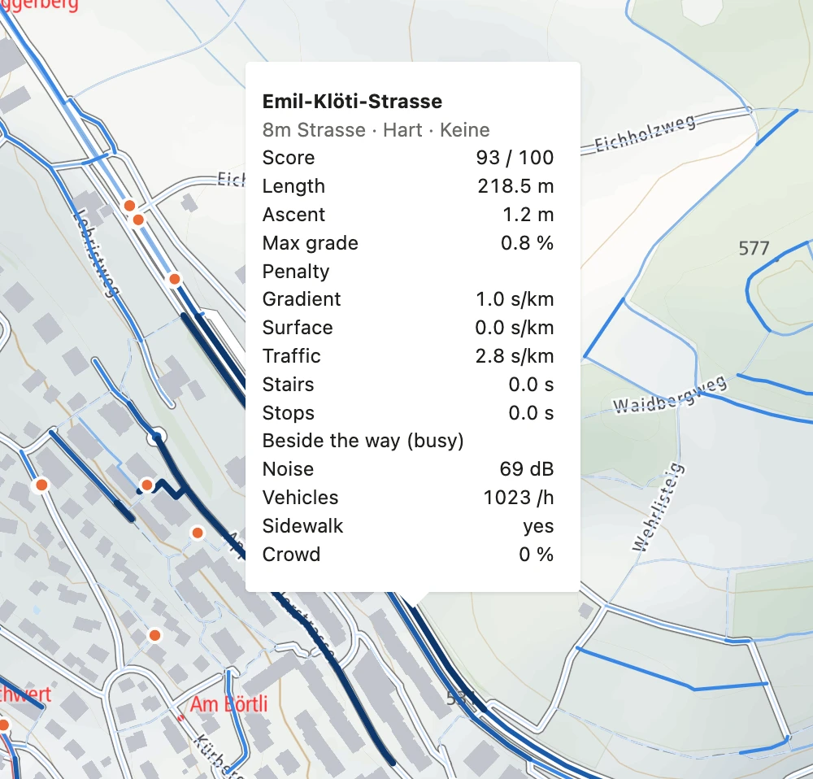

# flatarmac

**Find flat, uninterrupted running routes for pace-based training in Switzerland.**



Sweet-spot running without lactate measurements, as in the
[Norwegian Singles Method](https://www.goodreads.com/book/show/244528014), means going by pace on
flat ground. Heart rate is not a reliable enough proxy, as it lags behind lactate levels. Living in
a hilly area, I was looking for flat places to run close by. flatarmac finds loops and flat
stretches that allow just that. Talking with friends, it might also be useful for parents planning
stroller runs.

Working out what makes a "good" running section is not that straightforward, and it depends
largely on the data behind it. I was already a big fan of Switzerland's open national datasets, and
this project only reinforced that. flatarmac builds on them, so for now it works in Switzerland
only (see [Beyond Switzerland](#beyond-switzerland)). I have downloaded them for my surroundings in
Zürich and prebuilt the region. If flatarmac becomes more popular, I'm happy to do the same for the
entire country. Until then, you can build your own region as described below.

## Install

flatarmac runs on your own computer: it downloads the open data, builds the route network and opens
the map in your browser. Nothing is hosted or shared.

1. Install [uv](https://docs.astral.sh/uv/getting-started/installation/).
2. Install flatarmac:

   ```bash
   uv tool install git+https://github.com/fabitosh/flatarmac
   ```

3. Get the area you run in. I prebuilt greater Zürich (the map below, ~90 MB):

   ```bash
   flatarmac download
   ```

   For anywhere else in Switzerland, build your own region around a place, municipality or
   postcode:

   ```bash
   flatarmac setup "Bern"
   ```

4. Open the map at <http://localhost:8765>:

   ```bash
   flatarmac serve
   ```



The first `setup` takes a while: it downloads the national road dataset (~0.9 GB) and queries
OpenStreetMap through public servers that can be slow. If it stops, run the same command again: it
picks up where it left off.

- **Several regions:** pick one with `flatarmac --region bern serve`.
- **Update:** `uv tool upgrade flatarmac`.
- **Where the data lives:** `~/Library/Application Support/flatarmac` on macOS,
  `~/.local/share/flatarmac` on Linux, or wherever `FLATARMAC_DATA` points.

## Plan a run

Click the map to set your start, fill in your session and press **Find routes**. The suggestions
don't update on their own: after changing anything, press **Find routes** again. Each suggestion
comes with a GPX download for your watch.

### Why a road scores the way it does



Click any road for its details. Everything that slows you down or breaks your rhythm is priced in
seconds per km: gradient, surface, traffic beside you, stairs and stops on the way. Junctions with
traffic lights or busy crossings show as orange dots, sized by their typical delay. The score is
`100 / (1 + penalty / 50)`: about 4 s/km of penalties gives the 93 above; 50 s/km gives a 50.

## Running tracks

I consider running tracks the golden standard for running workouts. Had there been one close to my
home, I would not have built flatarmac.

Every track within reach of your warm-up is suggested on top of the road routes, and marked purple
on the map. Tracks come from a curated list built from OpenStreetMap: for greater Zürich,
[tracks_zurich.csv](src/flatarmac/curated/tracks_zurich.csv) holds 37 running tracks with their lap
length and surface. For a new region, `setup` drafts the list. It is meant as the start of a dataset
of running tracks in Switzerland, so if one is missing or wrong, please
[open an issue](https://github.com/fabitosh/flatarmac/issues).

## Development

Clone the repository and run flatarmac from the checkout with `uv run`. There is no install step:
uv builds the environment from `uv.lock` on first use, and your edits apply straight away.

```bash
git clone https://github.com/fabitosh/flatarmac
cd flatarmac
uv run flatarmac download   # greater Zürich, into data/
uv run flatarmac serve
```

From a checkout, data goes to `data/` (git-ignored) instead of your user data folder, and the
curated lists are read from and written to `src/flatarmac/curated/`, so changes to them land in git.

```bash
uv run pytest                                   # reference-route tests need data/zurich built
uv run ruff check && uv run ruff format --check
```

The reference-route tests check that real runs around Zürich come up in the top five suggestions.
They are skipped until `data/zurich` is built.

### How it fits together

1. **fetch** downloads the sources into `data/<region>/`: swissTLM3D roads, swissALTI3D terrain,
   OpenStreetMap stops, crossings, sidewalks, shops and tracks, sonBASE road noise and ARE traffic
   loads. The national road file goes to `data/raw/` and is shared by all regions.
2. **build** turns them into a scored network: `edges`, `nodes`, `turns`, `strokes` (long,
   straight-ish chains for out-and-backs) and `tracks`, each a Parquet table in `data/<region>/`.
   Every cost is in seconds, so a climb, a traffic light and a crowded street trade off in one
   unit. Open `edges.parquet` in QGIS to see every attribute.
3. **serve** starts a FastAPI server holding the planner. The page is a single MapLibre file,
   [web/index.html](src/flatarmac/web/index.html), and the map layers are built from the tables
   when the server starts.

`setup` runs fetch, drafts the track list, then runs build. The reasoning and decisions behind the
cost model and planner are in [PLAN.md](PLAN.md).

| Command | What it does |
|---|---|
| `setup <place>` | Set up a new region: fetch, track list, build |
| `download [name]` | Install a prebuilt region from the latest release (default `zurich`) |
| `serve` | The web UI (`--port`, `--no-browser`) |
| `fetch`, `build`, `all` | Run the pipeline steps one at a time (`all` runs both) |
| `tracks` | Update the track list from OpenStreetMap: `--discover` queries it again, `--add relation/123` adds one |
| `bundle` | Pack a built region into `data/dist/region-<name>.tar.gz` |
| `plan` | The planner without the browser: GeoJSON and GPX files in `data/<region>/routes/` (`--help` for options) |

With more than one region set up, put `--region <name>` before the command.

### Curated lists

Two hand-edited CSV files per region, in `src/flatarmac/curated/`. An installed flatarmac reads
them from the data folder's `curated/` instead, falling back to the lists it ships with. Run
`flatarmac build` after editing either.

- **`tracks_<region>.csv`**: running tracks by OpenStreetMap id, with `lap_m`, `surface` and an
  `include` switch. Fix a lap length or name by hand; use `tracks --discover` or `tracks --add` to
  pick up new ones.
- **`closures_<region>.csv`**: roads the map shows as open that are not (fenced sites, paths
  closed for years), by swissTLM3D `tlm_uuid` with a note on why. The build leaves them out.

### Beyond Switzerland

flatarmac doesn't support other countries yet, but porting it is feasible. The planner, the cost
model, the web UI and everything taken from OpenStreetMap don't depend on the country. What is
Swiss is the data the build reads:

| Swiss source | Used for | Elsewhere |
|---|---|---|
| **swissTLM3D** roads | The network: road class, hard or natural surface, bridges, tunnels, stairs. Its 3D lines also give the gradients, following bridge decks and underpasses. | OpenStreetMap `highway`, `surface`, `bridge`, `tunnel`. OSM lines are flat, so heights come from a terrain model, carried across bridges and tunnels. OSM ways also need splitting at shared nodes. This is the biggest piece of work. |
| **swissALTI3D** terrain (2 m) | Heights for running tracks | Many countries publish open 1 m lidar terrain models. The global 30 m models are too coarse for short ramps. |
| **sonBASE** noise, **ARE** traffic loads | How busy a road is, by time of day | Optional: missing noise already counts as quiet, and missing volumes fall back to the road class. fetch and build would need to skip them. |
| **LV95** coordinates | Regions on a 1 km grid, all geometry in metres | A UTM zone per region |
| **geo.admin.ch** search, swisstopo base map | Place names for `setup`, the map background | Nominatim, any OpenStreetMap vector style |

## Data and attribution

Nothing downloaded is committed or redistributed; `setup` and `fetch` pull it into the data folder.

- Roads (swissTLM3D), elevation (swissALTI3D) and the base map: © [swisstopo](https://www.swisstopo.admin.ch/),
  open government data.
- Road traffic noise (sonBASE): © [BAFU](https://www.bafu.admin.ch/), and road traffic loads
  (national passenger transport model): © [ARE](https://www.are.admin.ch/), both open government
  data via [geo.admin.ch](https://data.geo.admin.ch/).
- Stops, crossings, sidewalks, pedestrian areas, shops, stations and running tracks:
  © [OpenStreetMap](https://www.openstreetmap.org/copyright)
  contributors, ODbL. `tracks_<region>.csv` is derived from OpenStreetMap and shared under
  the same licence.
